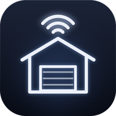
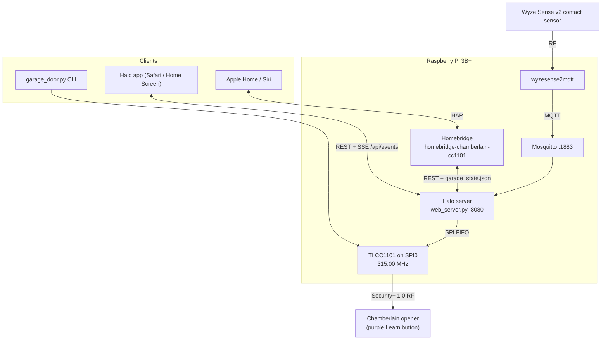

<p align="center"></p>

<h1 align="center">Halo</h1>
<p align="center"><b>Smart home automation for the garage.</b><br>
A Raspberry Pi + CC1101 that becomes a real Chamberlain Security+ 1.0 remote, with an iOS-style app, Apple Home and a Wyze contact sensor for ground truth.</p>

---

Halo drives Chamberlain, LiftMaster and Craftsman openers with the **purple Learn button** (315 MHz, Security+ 1.0 rolling code). No relay wired into the opener: Halo pairs as a new remote, the same way a handheld one does.

## Highlights

* **Real virtual remote.** Generates valid Security+ 1.0 rolling codes and transmits them from the CC1101's hardware FIFO, so Linux scheduling jitter never touches the waveform.
* **The Halo app.** An iOS-style web app you add to your Home Screen: a live door view, Apple Home–style accessory tiles, an activity feed and a full device admin page (pairing, rolling-code resync, RF test, new remote ID). It follows the system light/dark setting and becomes an iPad-style sidebar layout on wide screens.
* **Live, not polled.** The server pushes state over Server-Sent Events only when something changes. The app is idle while nothing happens and disconnects when it is in the background.
* **Courtesy light.** One tap presses the opener's light button (remote button 1). Halo can't see the light, so it shows **Possibly on**, with Chamberlain's 4.5-minute auto-off as a countdown.
* **Door alerts.** Notifications when the garage door opens, closes or is left open, with a Close button. No Apple home hub needed.
* **Local-first.** Door, light, sensor and HomeKit all run on your LAN. Losing the internet or Tailscale never stops the garage, and Halo reconnects within seconds when the network blips.
* **Ground-truth sensing.** A Wyze Sense v2 contact sensor over MQTT (or any integration that POSTs to `/api/sensor`) overrides the simulated door position.
* **Is the car home?** An optional Wyze motion sensor in the bay lets Halo estimate whether the car is in the garage, and you can correct it with a tap.
* **Auto-close.** Closes the door after it's been left open, but only when the contact sensor confirms it's open, after a warning with **Keep open**, and not while someone's moving in the garage.
* **Sensors & bridge.** Pair Wyze sensors and choose what each one does from the app. If the USB bridge drops or is replugged, Halo reconnects it automatically.
* **Remote lock.** While it is on, every door command is refused, including from HomeKit.
* **Apple Home & Siri.** Bundled Homebridge plugin exposes the door and the light.

## Architecture



---

## Hardware

1. **Raspberry Pi 3B+** (or any 40-pin Pi running Raspberry Pi OS).
2. **TI CC1101** sub-1 GHz module with a 315 MHz antenna.
3. *(Optional)* **Wyze Sense v1 USB bridge (WHSB1)** + **Wyze Sense v2 contact sensor**.
4. 6 female-to-female jumper wires.

> [!CAUTION]
> **3.3 V only.** Connecting the CC1101's VCC to 5 V destroys it.

| CC1101 | Raspberry Pi | Header pin | Notes |
| :--- | :--- | :--- | :--- |
| **VCC** | 3.3 V | **1** (or 17) | 3.3 V only |
| **GND** | Ground | **6** (or 9, 14, 20, 25) | |
| **CSN** | GPIO 8 (SPI0 CE0) | **24** | Chip select |
| **SCK** | GPIO 11 (SPI0 SCLK) | **23** | Clock |
| **MOSI** | GPIO 10 (SPI0 MOSI) | **19** | |
| **MISO** | GPIO 9 (SPI0 MISO) | **21** | |
| *GDO0* | *GPIO 24* | *18* | *Only for `--mode async`* |
| *GDO2* | — | — | *Not connected* |

---

## Install

```bash
# 1. Enable SPI: Interfacing Options → SPI → Enable, then reboot
sudo raspi-config
ls -l /dev/spidev0.*          # expect /dev/spidev0.0 /dev/spidev0.1

# 2. Get Halo
cd ~
git clone https://github.com/Izem07/Garage-Door-Opener-Cloner.git
cd Garage-Door-Opener-Cloner
sudo apt update
sudo apt install -y python3-pip python3-spidev python3-paho-mqtt mosquitto-clients
pip3 install -r requirements.txt --break-system-packages
cp remote_config.example.json remote_config.json

# 3. Check the radio
python3 garage_door.py status
```

```text
============================================================
 Halo - Security+ 1.0 (Purple Button 315MHz)
============================================================
Remote Fixed ID   : 0x25BAC093
Rolling Counter   : 1000
CC1101 Hardware   : CONNECTED
Chip Version      : 0x14 (Valid CC1101 silicon)
Radio State       : 0x01 (0x01 = IDLE)
============================================================
```

---

## The Halo App

```bash
python3 garage_door.py web --port 8080
```

Open `http://<PI_IP>:8080` on any phone, tablet or computer on your network. With no CC1101 attached (for example on a laptop), Halo runs in **simulation mode** so you can try the app safely; the status pill in the top right shows **Simulation**.

| Tab | What's there |
| :--- | :--- |
| **Home** | Door state and position, one-tap Open/Close, Light / Remote Lock / Contact / Car tiles, recent events |
| **Activity** | Last 20 events with source and result |
| **Device** | Remote ID and rolling code, CC1101 registers, door and motion sensor battery and signal, pairing guides, rolling-code resync, RF test, new remote ID, appearance |

**Add to iPhone Home Screen:** open the URL in Safari → **Share** → **Add to Home Screen**. Halo then launches full screen with its own icon, like a native app.

### Configuration (`remote_config.json`)
Halo keeps the rolling code in this file. Optional keys:

| Key | Default | Purpose |
| :--- | :--- | :--- |
| `repeats_per_press` | `8` | Bursts per button press |
| `sensor_mac` | — | Door contact sensor MAC. When set, only this sensor can change the door state |
| `car_sensor_mac` | — | Motion sensor MAC used for car presence |
| `auto_close.enabled` / `minutes` | off / `10` | Close the door if left open (set from the app) |
| `bridge.watchdog` / `container` | on / `wyzesense2mqtt` | Wyze bridge auto-reconnect |
| `notifications.*` | off | Door alerts: `enabled`, `server`, `topic`, `left_open_minutes`, `on_open`, `on_close` (set from the app) |
| `sensor_name` / `car_sensor_name` | `Garage Door Sensor` / `Car Bay Motion` | Friendly names shown in the app and activity log (rename in **Device → Name**) |
| `car_detection.before_open_sec` / `after_close_sec` | `120` / `120` | How far before opening and after closing Halo looks for motion |
| `mqtt.enabled` / `broker` / `port` | `true` / `127.0.0.1` / `1883` | Local MQTT broker (use a LAN IP, never a Tailscale address) |
| `mqtt.topic` | `wyzesense2mqtt/#` | Wyze sensor topic |
| `mqtt.base_topic` | `halo/garage` | Prefix for Halo's state and command topics |
| `mqtt.username` / `password` | — | Broker login, if your broker requires one |

### Run on boot (systemd)

Halo listens on every interface from the moment it starts, so it doesn't wait for Wi-Fi or the internet at boot. It works the moment the LAN is up.

```bash
sudo tee /etc/systemd/system/halo.service > /dev/null << 'EOF'
[Unit]
Description=Halo smart garage
After=network.target mosquitto.service

[Service]
Type=simple
User=izem07
WorkingDirectory=/home/izem07/Garage-Door-Opener-Cloner
ExecStart=/usr/bin/python3 garage_door.py web --port 8080
Restart=always
RestartSec=5

[Install]
WantedBy=multi-user.target
EOF

sudo systemctl daemon-reload
sudo systemctl enable --now halo.service
```

> Upgrading from the old `garage-door.service`? Run `sudo systemctl disable --now garage-door.service` first so both don't try to bind port 8080.

---

## Pairing

You can also do both of these from **Device → Pairing** in the app, which walks you through each step.

### Door (button 0)
1. Press and release the **purple Learn** button on the ceiling motor. Its LED stays on for 30 s.
2. Within 30 s: `python3 garage_door.py pair`
3. The opener lights blink when the code is accepted.

### Courtesy light (button 1)
The light pairs from the multi-function wall console, not from the Learn button:
1. Make sure the door is **closed**.
2. On the wall console, hold **LIGHT**, then also hold **LOCK**.
3. While holding both: `python3 garage_door.py pair-light`
4. Keep holding until the opener lights flash.

---

## Wyze Sensors: Door Contact (Ground Truth) & Car Motion

A Wyze Sense v2 contact sensor reports the real door position, and an optional Wyze Sense motion sensor lets Halo estimate whether the car is in the garage. Both pair to a Wyze v1 USB bridge (`1a86:e024`) on the Pi, and Halo receives them over MQTT. Halo tells the two apart by MAC, so motion can never be mistaken for the door opening.

### Where to put the contact sensor
Put it at the **top of the door**:
* **Sensor body:** on the wall or header just above the door opening, near the top centre or a top corner.
* **Magnet:** on the top edge of the **top door panel**, lined up with the sensor and within about 2 cm when the door is closed.
* The top panel only meets the header when the door is fully down, so the sensor reads **open** if the door stops even a little way up. Up there it's also clear of cars, bikes, water and road salt.
* **Steel door?** If the magnet sticks to the panel and the reading is flaky, put a 3–5 mm plastic or wood spacer under the magnet.
* **Check it before you stick it down:** open and close the door a few times and watch **Device → Contact Sensor** in Halo.
* Garages get cold, and the sensor's coin cell fades faster in winter. Halo shows its battery level.

### Where to put the motion sensor (car presence)
A motion sensor sees **movement and warm bodies**, not a parked car, so it can't simply "see" whether the car is there. Halo works it out from motion around each door cycle instead:

| What happened | Halo concludes |
| :--- | :--- |
| Motion **before** the door opened, none **after** it closed | Someone got in and drove out: **car away** |
| No motion before opening, motion **after** it closed | Someone drove in and got out: **car in the garage** |
| Motion before **and** after, or none at all | Someone walked through: **no change** |

It's an estimate, so you can tap **Car** in the app to correct it at any time. For the estimate to work:
* **Mount it at the back of the bay**, about 2 m up on the back wall or the wall beside the car, **facing the driver's door and the path to the house door**.
* **Don't let it see the garage door.** Moving door panels, sunlight and street heat through the open door all cause false triggers.
* Keep it away from heater vents, the water heater and the opener motor.
* If you usually take more than 2 minutes to get in and leave, raise `car_detection.before_open_sec`.

> For a definite yes/no rather than an estimate, a ceiling-mounted distance sensor above the car's hood is the reliable option (an HC-SR04 ultrasonic or VL53L1X laser sensor wired to the Pi). Halo's `/api/car` endpoint is ready for it.

```bash
# Mosquitto broker
sudo docker run -d --name=mosquitto --restart=always --net=host eclipse-mosquitto:latest
mkdir -p /home/izem07/wyzesense-config
```

`/home/izem07/wyzesense-config/config.yaml`:
```yaml
mqtt_host: 127.0.0.1
mqtt_port: 1883
mqtt_client_id: wyzesense2mqtt
self_topic_root: wyzesense2mqtt
usb_dongle: auto
hass_discovery: true
```

`/home/izem07/wyzesense-config/sensors.yaml`:
```yaml
77CB8338:
  name: Garage Door
  sensor_type: switch
AABB1122:            # your motion sensor's MAC (printed on the sensor)
  name: Garage Car Bay
  sensor_type: motion
```

The easiest way to tell Halo which sensor is which is from the app (see [Adding sensors](#adding-sensors-from-the-app)). You can also set it in `remote_config.json`:
```json
"sensor_mac": "77CB8338",
"car_sensor_mac": "AABB1122"
```

Each sensor shows up in the app under a friendly name (**Garage Door Sensor** and **Car Bay Motion** by default). To rename one, tap **Device → Name** (or **Motion Sensor**). The sensor's ID (MAC) is still listed underneath so you can match it to the label on the sensor.

```bash
sudo docker run -d --name=wyzesense2mqtt --restart=unless-stopped --privileged --net=host \
  -v /dev:/dev -v /home/izem07/wyzesense-config:/app/config \
  -e MQTT_HOST=127.0.0.1 -e MQTT_PORT=1883 \
  raetha/wyzesense2mqtt:latest
```

Halo understands both the classic `wyzesense2mqtt/<MAC>` topics and the newer `ws2m/sensor/<MAC>` layout.

### Adding sensors from the app
**Device → Sensors** lists every Wyze sensor the bridge knows about, with its type, battery and last report.

* **Add Sensor:** tap **Start Pairing**, then hold the new sensor's reset button with a pin until its light blinks. It appears in the sheet within a few seconds. Tap it and choose **Use for Garage Door** (contact sensors) or **Use for Car** (motion sensors). That's saved to `remote_config.json` for you.
* **Tap any sensor** to change its job, rename it, stop using it, or **Remove from Bridge** (unpairs it).
* Pairing goes through the Wyze bridge (`wyzesense2mqtt/scan` and `/remove` over MQTT), so the MQTT broker and wyzesense2mqtt must be running.

### Bridge auto-reconnect
USB bridges drop off: a loose cable, a power blip, or the Pi renumbering USB devices. Halo watches for this every 15 s and fixes it:

| What Halo sees | What it does |
| :--- | :--- |
| Bridge unplugged | Shows **Unplugged** in the app, then restarts wyzesense2mqtt as soon as it's plugged back in |
| wyzesense2mqtt container stopped | Restarts it |
| Restart doesn't work | Tries again after 30 s, 1, 2, 5, then every 15 min, so a broken bridge isn't hammered |

Sensors are paired inside the bridge itself, so after a reconnect they report again on their own with **no re-pairing**. **Device → Wyze Bridge** shows the status and a **Restart Bridge Now** button, and lets you turn auto-reconnect off.

Halo needs permission to restart the container. Give its user Docker access once, then reboot:
```bash
sudo usermod -aG docker izem07
```

Also install this udev rule. It gives the bridge a stable name and restarts wyzesense2mqtt the instant the bridge is plugged in, even if Halo isn't running. `systemd-run --no-block` keeps udev from stalling while Docker restarts:
```bash
sudo bash -c 'cat << "EOF" > /etc/udev/rules.d/99-wyzesense.rules
KERNEL=="hidraw*", ATTRS{idVendor}=="1a86", ATTRS{idProduct}=="e024", MODE="0666", SYMLINK+="wyzesense", TAG+="systemd", RUN+="/usr/bin/systemd-run --no-block /usr/bin/docker restart wyzesense2mqtt"
EOF'
sudo udevadm control --reload-rules && sudo udevadm trigger
```

Different container name or no Docker? Set `bridge.container`, or your own `bridge.restart_command` / `bridge.status_command`, in `remote_config.json`.

No Wyze hardware? Any integration can report the door with `POST /api/sensor {"state": "open"}` and motion with `POST /api/motion {"motion": true}`.

---

## Apple Home (HomeKit) via Homebridge

The plugin lives in `homebridge-chamberlain-cc1101/`.

```bash
sudo cp -r ~/Garage-Door-Opener-Cloner/homebridge-chamberlain-cc1101/* \
  /var/lib/docker/volumes/homebridge_data/_data/homebridge-chamberlain-cc1101/
sudo docker exec -w /homebridge homebridge npm install /homebridge/homebridge-chamberlain-cc1101
```

Add to `"accessories"` in Homebridge's `config.json` (or use the plugin's settings page in the Homebridge UI), then `sudo docker restart homebridge`:
```json
{
  "accessory": "ChamberlainCC1101",
  "name": "Garage Door",
  "apiUrl": "http://127.0.0.1:8080",
  "lightName": "Garage Light"
}
```

`127.0.0.1` works when Homebridge's container uses host networking (`--net=host`). Otherwise use the Pi's home-network IP.

What you get in Apple Home:

* **Garage Door**, which follows Halo live. Halo pushes every change to the plugin instantly (with polling every 3 s as a fallback if that connection drops). A door opened by the wall button or a handheld remote shows up in Home within about a second, as soon as the contact sensor reports it.
* **Garage Light**, a button-style switch. Tap it and Halo presses the opener's light button; the switch flips back off by itself. Halo can't see the light, so there's no on/off state to get wrong. "Hey Siri, turn on Garage Light" works, and "turn off" presses the same button.
* Open and close are explicit, so "open" never closes an already-open door. If Halo's remote lock is on, Home shows an error and snaps back instead of pretending the door moved.
* Halo is the only thing that writes `garage_state.json`; the plugin just follows Halo.
* Siri: *"Hey Siri, open the garage door"*, *"Is the garage door closed?"*, *"Turn on Garage Light."*

> **Upgrading from plugin 1.x:** the light used to be a lightbulb called "Garage Door Light". It's now a switch called "Garage Light", so re-add it to any scenes or automations that used the old one.

**Notifications:** Apple Home only sends accessory notifications through a home hub (Apple TV or HomePod). Without one, use Halo's own [door alerts](#door-alerts-notifications) instead.
* Away from home: an Apple Home hub, or the Halo app over Tailscale. See [Local-first](#local-first-no-internet-or-tailscale-required).

---

## Auto-Close

Halo can close the garage door if it's been left open. Turn it on in **Device → Auto-Close** and pick 5, 10, 15, 30 or 60 minutes.

The opener's remote is a toggle: the same press opens a closed door. So auto-close has strict rules:

* **It only closes when the contact sensor confirms the door is open.** If Halo can't confirm it, it waits and tells you why. It never acts on a guess.
* **It warns you first.** A minute before closing, the Home screen shows **Closing in 0:59 · Keep Open**, and if [door alerts](#door-alerts-notifications) are on you get a notification with a **Keep open** button. Keep Open lasts until the door next closes.
* **It waits while someone's in the garage.** If the car motion sensor saw movement in the last 2 minutes, it holds off and checks again a minute later.
* **It tries once.** If the door is still open shortly after (for example, the safety sensors saw something and the opener reversed), you get a **Garage door did NOT close** alert and Halo doesn't try again until the next time the door opens.
* It works even with the remote lock on, because closing is the safe direction.

> ⚠️ Closing a door nobody is watching is only safe with working **safety sensors** (the photo-eyes near the floor). Test them before relying on auto-close: block the beam while the door is closing and it must reverse.

---

## Door Alerts (Notifications)

Halo can notify your phone when the **garage door** opens, closes, or is left open. Only the door sends alerts: the light, motion sensor and car never do. Alerts go through the free **ntfy** app, so no Apple home hub is needed.

1. Install **ntfy** on your iPhone (App Store) and allow notifications.
2. In Halo, go to **Device → Door Alerts** and turn on **Notify Me**. Halo creates a private, hard-to-guess topic name such as `halo-5d887f447e0c0a1b`.
3. Tap **ntfy Topic** to copy it. In ntfy, tap **+**, paste the topic, and subscribe.
4. Tap **Send Test Notification** in Halo.

| Alert | When |
| :--- | :--- |
| **Garage door opened** | Every opening, with who did it: Halo app, HomeKit, MQTT, or "remote or wall button" (spotted by the contact sensor) |
| **Garage door closed** | Every closing, with how long it was open |
| **Garage door left open** | After 5, 10 or 30 minutes (your choice), repeated up to 3 times. It has a **Close door** button, which works when your phone can reach Halo (home Wi-Fi or Tailscale) |

You can switch "When Opened" and "When Closed" off and keep only the left-open reminder.

* Alerts are sent from a background thread and retried for about a minute, so a slow or missing internet connection never delays the door. Opening and closing keep working with no internet; only the alert has to wait.
* Want everything self-hosted? Run your own ntfy server and set its address in `remote_config.json` (`notifications.server`).
* Tapping an alert opens Halo at the address you used when you turned alerts on.

---

## Local-first: No Internet or Tailscale Required

Everything that opens the door stays on your LAN. The internet and Tailscale are optional extras on top, never in the path:

```text
Siri / Home app ──HAP (Wi-Fi)──► Homebridge ──127.0.0.1──► Halo ──SPI──► CC1101 ──315 MHz──► opener
Halo app ──────────LAN─────────────────────────────────────► Halo
Wyze sensor ──► wyzesense2mqtt ──► Mosquitto (127.0.0.1) ──► Halo
```

When your modem loses internet or the router reboots, every one of those hops keeps working, and Halo recovers within seconds:

| Piece | How it stays local | Recovery |
| :--- | :--- | :--- |
| Halo server | Binds `0.0.0.0` with no cloud calls. The app loads nothing from the web | Starts at boot without waiting for the network |
| MQTT | Broker on the Pi (`127.0.0.1`) | Reconnects every 1–5 s (keep-alive 15 s) |
| Homebridge plugin | Talks to Halo on `127.0.0.1` | 3 s timeout, fresh connection per request |
| Halo app | Same-origin requests to the Pi | Live push reconnects in 1 s, polls every 2 s meanwhile, reconnects the moment Wi-Fi returns |

### One-time network setup (on your router)
1. **Reserve fixed IPs.** Create a DHCP reservation for the Pi (and the Homebridge host if it's a separate machine) so the address never changes after a router reboot.
2. **Use the LAN address everywhere.** Bookmark `http://<pi-ip>:8080` or `http://<pi-hostname>.local:8080` for the app, and point `apiUrl` and `mqtt.broker` at `127.0.0.1` or the Pi's LAN IP, **never a Tailscale `100.x` / `.ts.net` address**.
3. **Pair Homebridge on Wi-Fi.** Add the bridge in the Home app while on your home network. Apple Home talks to it directly over HAP.

### Away from home
* **Apple Home:** an Apple Home hub on your LAN relays commands, so no Tailscale is needed on your phone.
* **Halo app, SSH, admin:** use Tailscale. It's only an overlay for remote access, so turning it off on your phone at home changes nothing.

**Quick test:** unplug the modem's internet cable (leave the router and Wi-Fi on). Opening and closing from the Home app, Siri and the Halo app should all still work instantly on Wi-Fi.

### MQTT topics (local broker)
Use these with any local MQTT client, such as Homebridge `mqttthing` or Home Assistant, as an alternative to the Homebridge plugin.

| Topic | Direction | Payload |
| :--- | :--- | :--- |
| `halo/status` | Halo → broker (retained, last-will) | `online` / `offline` |
| `halo/garage/state` | Halo → broker (retained) | `{"door":"closed","percent":0,"light":"off","lock":"off",...}` |
| `halo/garage/door` | Halo → broker (retained) | `open` · `closed` · `opening` · `closing` |
| `halo/garage/light` · `halo/garage/lock` | Halo → broker (retained) | `on` · `off` |
| `halo/garage/door/set` | you → Halo | `open` · `close` · `toggle` |
| `halo/garage/light/set` | you → Halo | any payload presses the light button (toggle) |
| `halo/garage/lock/set` | you → Halo | `on` · `off` |
| `halo/garage/car` | Halo → broker (retained) | `present` · `away` · `unknown` |
| `halo/garage/motion` | Halo → broker (retained) | `on` · `off` |
| `halo/garage/car/set` | you → Halo | `present` · `away` (manual correction) |

`open` while the door is already open (or opening) does nothing, and likewise for `close` and light `on`/`off`. Retained `/set` messages are ignored, so a stale command can never replay after a reconnect. The remote lock blocks door commands here too.

---

## CLI Reference

| Command | Description |
| :--- | :--- |
| `python3 garage_door.py toggle` | Open/close the door (advances the rolling code) |
| `python3 garage_door.py light` | Toggle the courtesy light (button 1) |
| `python3 garage_door.py pair` | Send door pairing bursts (after pressing Learn) |
| `python3 garage_door.py pair-light` | Send light pairing bursts (wall console) |
| `python3 garage_door.py status` | Remote ID, rolling code and CC1101 registers |
| `python3 garage_door.py set-counter <n>` | Resync the rolling code |
| `python3 garage_door.py reset-remote` | Generate a new virtual remote ID |
| `python3 garage_door.py test-rf -d 5` | Transmit test bursts for SDR verification |
| `python3 garage_door.py web --port 8080` | Start the Halo server |

Global flags: `--config`, `--spi-bus`, `--spi-device`, `--mode fifo|async`, `--gdo0 <bcm-pin>`.

---

## REST API

| Endpoint | Method | Body | Description |
| :--- | :--- | :--- | :--- |
| `/api/status` | GET | — | Full state: door, light, sensor, lock, radio, recent events |
| `/api/events` | GET | — | Server-Sent Events: a full status object on every change, keep-alive every 15 s |
| `/api/logs` | GET | — | Last 50 events |
| `/api/toggle` | POST | `{"source": "Shortcut"}` | One door-button press. Returns **423** while the remote lock is on |
| `/api/open` · `/api/close` | POST | — | Open / close, and does nothing if the door is already there or heading there. **423** when locked |
| `/api/light` | POST | `{"source": "Halo app"}` | Press the light button. Always a toggle; the reply's `light_on` is only an estimate |
| `/api/light/state` | POST | `{"on": true}` | Report light state from an external sensor (no RF) |
| `/api/notifications` | POST | `{"enabled": true, "left_open_minutes": 10}` | Door alert settings (also `on_open`, `on_close`, `server`, `topic`) |
| `/api/notifications/test` | POST | — | Send a test alert |
| `/api/auto-close` | POST | `{"enabled": true, "minutes": 10}` | Auto-close settings |
| `/api/auto-close/hold` | POST | — | Keep the door open until it next closes |
| `/api/sensors/pair` | POST | `{"seconds": 60}` | Put the Wyze bridge in pairing mode |
| `/api/sensors/assign` | POST | `{"mac": "77CB8338", "role": "door"}` | Use a sensor for `door`, `car` or `none` |
| `/api/sensors/remove` | POST | `{"mac": "77CB8338"}` | Unpair a sensor from the bridge |
| `/api/bridge/restart` | POST | — | Restart the Wyze bridge now |
| `/api/bridge` | POST | `{"watchdog": true}` | Turn bridge auto-reconnect on or off |
| `/api/sensor` | POST | `{"state": "open"}` or `{"contact": false}` | Ground-truth door state |
| `/api/motion` | POST | `{"motion": true}` | Report car-bay motion from any integration |
| `/api/car` | POST | `{"present": true}` | Set car presence (manual correction or a distance sensor) |
| `/api/sensor-name` | POST | `{"sensor": "door", "name": "Side Door"}` | Rename the `door` or `motion` sensor (1–32 characters) |
| `/api/lock` | POST | `{"locked": true}` | Set the remote lock (omit `locked` to toggle) |
| `/api/pair` | POST | `{"repeats": 16}` | Door pairing bursts |
| `/api/pair-light` | POST | `{"repeats": 24}` | Light pairing bursts |
| `/api/set-counter` | POST | `{"counter": 1200}` | Set the rolling code |
| `/api/reset-remote` | POST | `{"start_counter": 1000}` | New virtual remote ID |
| `/api/test-rf` | POST | `{"duration": 3}` | RF test bursts (0.5–10 s) |

`repeats` is clamped to 1–32.

### Performance notes
* Status reads come from memory. CC1101 identity registers are read once at startup, and the state register only after a transmission, so polling never touches the SPI bus.
* Static files are cached in memory, gzip-compressed once (the app is about 12 KB on the wire) and served with ETags.
* The courtesy-light auto-off is a single timer, not a polling loop. Door travel updates 4×/s, and the UI animates between updates.
* `garage_state.json` is written atomically, so the Homebridge file watcher never reads a partial file.

---

## Security+ 1.0 Protocol

```text
315.00 MHz carrier | OOK | 500 µs base unit | 2 ms per symbol
```

1. **Ternary symbols** (2.0 ms each):
   * `0`: 500 µs on, 1500 µs off
   * `1`: 1000 µs on, 1000 µs off
   * `2`: 1500 µs on, 500 µs off
2. **Two frames per press**, 20 data symbols each:
   * Frame 1 starts with sync `0`, frame 2 with sync `2`. Each frame is followed by ~58 ms of silence.
3. **Payload:** the 40 symbols interleave the **32-bit fixed remote ID**, the **rolling counter** and the **button** (0 = door, 1 = light).
4. **Rolling window:** the opener accepts codes up to ~256 steps ahead. If it stops responding, resync from **Device → Resync Rolling Code** or `set-counter`.

---

## RF Range

* **Antenna.** Most CC1101 modules ship with a 433 MHz spring. For 315 MHz use a quarter-wave wire:
  $$\lambda/4 = \frac{c}{4f} = \frac{3\times10^8}{4 \times 315\times10^6} \approx 23.8\text{ cm } (9.37\text{ in})$$
  Solder a straight 23.8 cm solid copper wire to the antenna pad, or fit a tuned 315 MHz SMA whip.
* **Power.** Use a supply rated for at least 2.5 A to avoid brownouts during transmissions.

---

## License

MIT. See [LICENSE](LICENSE).
