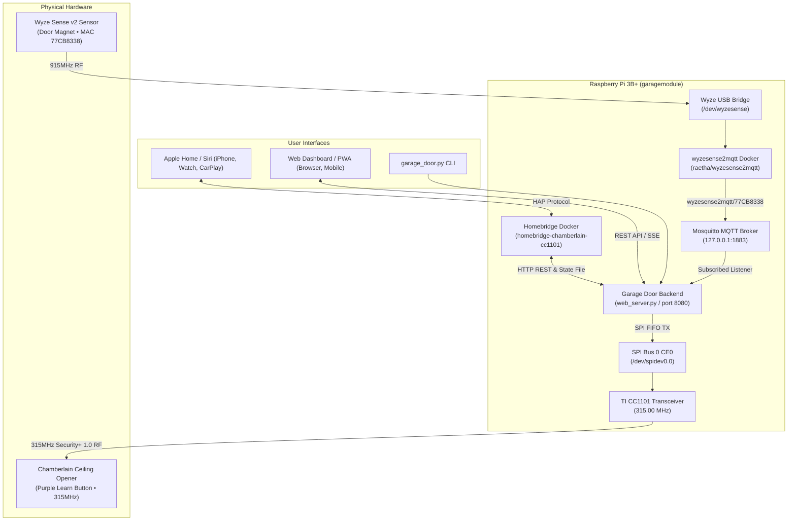

# Smart Garage Door Opener (Chamberlain Security+ 1.0 • 315 MHz)

Transform a **Raspberry Pi 3B+** and a **TI CC1101 Sub-1GHz RF transceiver** into a fully featured, ground-truth-aware smart garage door system with native **Apple HomeKit / Siri** integration, physical **Wyze Sense v2** contact sensing, and a modern **Konnected GDO blaQ-inspired Web Dashboard**.

Specifically engineered for Chamberlain, LiftMaster, and Craftsman garage door openers equipped with the **Purple "Learn" Button** (315.00 MHz, Security+ 1.0 rolling code protocol).

---

## Highlights

* **Genuine Virtual Remote (Security+ 1.0)**: Generates valid rolling codes and 40-symbol ternary frames at 315.00 MHz directly using CC1101 hardware SPI FIFO buffers (zero Linux OS timing jitter).
* **Opener Courtesy Light Control**: Emulates physical remote Button 1 to toggle the ceiling opener work lights independently, complete with a 4.5-minute auto-off timer mirroring Chamberlain factory behavior.
* **Ground-Truth Contact Sensing**: Integrates physical **Wyze Sense v2 Contact Sensors** via a Wyze v1 USB bridge (`WHSB1`) and MQTT for verified open/closed door states, battery percentage, and signal strength.
* **Apple HomeKit Native Bridge**: Custom Homebridge plugin (`homebridge-chamberlain-cc1101`) exposing the garage door and opener light with instant status reflection and Siri voice support.
* **Modern Web Dashboard & PWA**: Responsive Konnected GDO blaQ-style web interface featuring architectural animated door slats, volumetric overhead light beams, auto-off countdowns, tactile audio feedback, and dark/light modes.
* **Zero-Drop Hardware Resiliency**: Persistent Linux udev rules for plug-and-play Wyze USB bridge auto-reconnection and automated systemd background services.

---

## System Architecture



---

## Hardware Requirements & Pinout

### Required Components
1. **Raspberry Pi 3B+** (or any 40-pin Raspberry Pi running Raspberry Pi OS).
2. **TI CC1101 Sub-1GHz Transceiver Module** with 315 MHz tuned antenna.
3. **Wyze Sense v1 USB Bridge (Model WHSB1)** + **Wyze Sense v2 Contact Sensor**.
4. **6x Female-to-Female Jumper Wires**.

> [!CAUTION]
> **3.3V Power Only:** The CC1101 is strictly a **3.3V** device. Connecting VCC to a 5V pin will permanently destroy the transceiver.

### CC1101 to Raspberry Pi 3B+ Wiring Table

| CC1101 Pin | Raspberry Pi Function | Physical Header Pin | Notes |
| :--- | :--- | :--- | :--- |
| **VCC / VDD** | **3.3V Power** | **Pin 1** (or 17) | **3.3V ONLY** |
| **GND** | **Ground** | **Pin 6** (or 9, 14, 20, 25) | System ground |
| **CSN / CS** | **GPIO 8 (SPI0 CE0)** | **Pin 24** | SPI Chip Select 0 |
| **SCK / SCLK**| **GPIO 11 (SPI0 SCLK)**| **Pin 23** | SPI Bus Clock |
| **MOSI / SI** | **GPIO 10 (SPI0 MOSI)**| **Pin 19** | SPI Master Out Slave In |
| **MISO / SO** | **GPIO 9 (SPI0 MISO)** | **Pin 21** | SPI Master In Slave Out |
| *GDO0* | *GPIO 24 (Optional)* | *Pin 18* | *Only for bitbang mode; not needed in SPI FIFO mode* |
| *GDO2* | *Not Connected* | — | *Leave unconnected* |

---

## Software Installation & Setup

### 1. Enable SPI Interface on Raspberry Pi
```bash
sudo raspi-config
# Navigate to: Interfacing Options -> SPI -> Enable -> Yes
sudo reboot
```
Verify the SPI device nodes exist:
```bash
ls -l /dev/spidev0.*
# Expected output: /dev/spidev0.0  /dev/spidev0.1
```

### 2. Clone Repository & Install Python Dependencies
```bash
cd ~
git clone https://github.com/Izem07/Garage-Door-Opener-Cloner.git
cd Garage-Door-Opener-Cloner

# Install system and Python dependencies
sudo apt update
sudo apt install -y python3-pip python3-spidev python3-paho-mqtt mosquitto-clients
pip3 install -r requirements.txt --break-system-packages
```

### 3. Verify CC1101 Radio Communication
```bash
python3 garage_door.py status
```
Expected output:
```text
============================================================
 Garage Door Opener: Security+ 1.0 (Purple Button 315MHz)
============================================================
Remote Fixed ID   : 0x25BAC093
Rolling Counter   : 1000
CC1101 Hardware   : CONNECTED
Chip Version      : 0x14 (Valid CC1101 silicon)
Radio State       : 0x01 (0x01 = IDLE)
============================================================
```

---

## Wyze Contact Sensor Integration (Ground Truth)

The system uses a Wyze Sense v2 contact sensor paired to a Wyze v1 USB bridge (`1a86:e024`) plugged into the Pi.

### 1. Set Up Mosquitto MQTT & Wyze Bridge Docker
```bash
# Run Mosquitto MQTT broker on host network
sudo docker run -d \
  --name=mosquitto \
  --restart=always \
  --net=host \
  eclipse-mosquitto:latest

# Prepare persistent configuration folder
mkdir -p /home/izem07/wyzesense-config
```

Create `/home/izem07/wyzesense-config/config.yaml`:
```yaml
mqtt_host: 127.0.0.1
mqtt_port: 1883
mqtt_client_id: wyzesense2mqtt
self_topic_root: wyzesense2mqtt
usb_dongle: auto
hass_discovery: true
```

Create `/home/izem07/wyzesense-config/sensors.yaml`:
```yaml
77CB8338:
  name: Garage Door
  sensor_type: switch
```

### 2. Configure Persistent Udev Auto-Reconnect Rule
To prevent USB drops when the bridge is unplugged or re-enumerates from `/dev/hidraw0` to `/dev/hidraw1`:

```bash
sudo bash -c 'cat << "EOF" > /etc/udev/rules.d/99-wyzesense.rules
KERNEL=="hidraw*", ATTRS{idVendor}=="1a86", ATTRS{idProduct}=="e024", MODE="0666", SYMLINK+="wyzesense", TAG+="systemd", RUN+="/usr/bin/docker restart wyzesense2mqtt"
EOF'

sudo udevadm control --reload-rules && sudo udevadm trigger
```

### 3. Launch `wyzesense2mqtt` Container
```bash
sudo docker run -d \
  --name=wyzesense2mqtt \
  --restart=unless-stopped \
  --privileged \
  --net=host \
  -v /dev:/dev \
  -v /home/izem07/wyzesense-config:/app/config \
  -e MQTT_HOST=127.0.0.1 \
  -e MQTT_PORT=1883 \
  raetha/wyzesense2mqtt:latest
```

When the door opens or closes, `wyzesense2mqtt` publishes to `wyzesense2mqtt/77CB8338`, and the backend immediately updates `garage_state.json`, animated UI slats, and HomeKit.

---

## Pairing Procedures

### Pairing the Garage Door (Button 0)
1. Walk to your Chamberlain ceiling motor unit.
2. Press and immediately release the **PURPLE** Learn button. The amber/purple indicator LED will glow solid ON for 30 seconds.
3. Transmit the pairing sequence from the Pi within 30 seconds:
   ```bash
   python3 garage_door.py pair
   ```
4. **Confirmation**: The opener work lights will flash twice and the relay will click. The virtual remote is now permanently paired!

### Pairing the Opener Courtesy Light (Button 1)
Chamberlain Security+ 1.0 remotes use **Button 1** for the courtesy light. Opener ceiling units do not pair the light via the purple button; they pair via the multi-function wall console:
1. Ensure the garage door is currently **CLOSED**.
2. Go to the **Multi-Function Wall Door Control** inside the garage.
3. Press and hold the physical **LIGHT** button on the wall console.
4. While holding **LIGHT**, press and hold the **LOCK** button on the wall console.
5. While holding both buttons, transmit the light pairing burst from the Pi:
   ```bash
   python3 garage_door.py pair-light
   ```
6. Keep holding the wall buttons until the ceiling opener lights **flash**! The light is now paired.

---

## Native Apple HomeKit Integration

The repository includes a dedicated Homebridge accessory plugin located in `homebridge-chamberlain-cc1101/`.

### 1. Install Plugin in Homebridge Docker
```bash
sudo cp -r ~/Garage-Door-Opener-Cloner/homebridge-chamberlain-cc1101/* \
  /var/lib/docker/volumes/homebridge_data/_data/homebridge-chamberlain-cc1101/

sudo docker exec -w /homebridge homebridge npm install /homebridge/homebridge-chamberlain-cc1101
```

### 2. Configure Homebridge (`config.json`)
Add the accessory entry to the `"accessories"` array in `/var/lib/docker/volumes/homebridge_data/_data/config.json`:
```json
{
  "accessory": "ChamberlainCC1101",
  "name": "Garage Door",
  "apiUrl": "http://127.0.0.1:8080",
  "doorTravelTime": 12
}
```

Restart Homebridge:
```bash
sudo docker restart homebridge
```

### 3. Apple Home Features
* **Two Integrated Accessories**: "Garage Door" (Door Opener service) and "Garage Door Light" (Lightbulb service).
* **Dual-Layer Synchronization**: Combines instant inotify filesystem watches on `garage_state.json` with periodic 3-second HTTP status polling for zero-lag state tracking.
* **Siri Voice Commands**:
  * *"Hey Siri, open the garage door."*
  * *"Hey Siri, is the garage door closed?"*
  * *"Hey Siri, turn on the garage light."*
* **Remote Access (Outside Home)**: Requires an Apple Home Hub (Apple TV 4K, HomePod, or iPad) or a Tailscale tunnel to your local network.

---

## Web Dashboard & iOS PWA Setup

Run the dashboard manually or via systemd on port `8080`:

```bash
python3 garage_door.py web --port 8080
```

Access the interface from any phone, tablet, or PC on your network at `http://<PI_IP>:8080`.

### Key Dashboard Features
* **Volumetric Ceiling Light Simulation**: When the courtesy light is turned ON, the overhead fixture in the SVG graphic illuminates with bright golden bloom and casts translucent volumetric light rays down onto the door.
* **Ground-Truth Sensor Pill**: Displays live Wyze sensor MAC, signal strength (dBm), battery gauge (%), and connection state.
* **Live Auto-Off Countdown**: Displays `⏱ Auto-off 4:26` (mm:ss) counting down Chamberlain's 4.5-minute timeout.
* **Quick Presets**: "Vent 25%" (cracks door for ventilation) and "Open 100%".
* **Tactile Audio Feedback**: Mechanical sound synthesizer via Web Audio API with a one-tap mute button (`🔊`/`🔇`).
* **Dark & Light Modes**: Seamless high-contrast navy dark mode and crisp slate light mode with localStorage persistence.

### Add to iPhone Home Screen (PWA Mode)
1. Open Safari on iPhone and navigate to `http://<PI_IP>:8080`.
2. Tap the **Share** button (box with upward arrow).
3. Select **Add to Home Screen**.
4. The dashboard will launch fullscreen without browser chrome, complete with custom high-DPI app icons.

---

## Automatic Startup on Boot (systemd)

Enable `garage-door.service` to start on boot:

```bash
sudo tee /etc/systemd/system/garage-door.service > /dev/null << 'EOF'
[Unit]
Description=Chamberlain 315MHz Smart Garage Door Opener Backend
After=network.target mosquitto.service

[Service]
Type=simple
User=izem07
WorkingDirectory=/home/izem07/Garage-Door-Opener-Cloner
ExecStart=/usr/bin/python3 /home/izem07/Garage-Door-Opener-Cloner/garage_door.py web --port 8080
Restart=always
RestartSec=5

[Install]
WantedBy=multi-user.target
EOF

sudo systemctl daemon-reload
sudo systemctl enable --now garage-door.service
```

---

## CLI Command Reference

| Command | Description |
| :--- | :--- |
| `python3 garage_door.py toggle` | Toggle door open/closed (increments rolling counter) |
| `python3 garage_door.py open` | Open the garage door |
| `python3 garage_door.py close` | Close the garage door |
| `python3 garage_door.py light` | Toggle opener courtesy light (Button 1) |
| `python3 garage_door.py pair` | Transmit door pairing sequence (Purple button) |
| `python3 garage_door.py pair-light` | Transmit light pairing sequence (Wall console) |
| `python3 garage_door.py status` | Inspect hardware connection, rolling codes, and registers |
| `python3 garage_door.py set-counter <val>` | Manually advance or resynchronize the rolling counter |
| `python3 garage_door.py reset-remote` | Generate a new random Virtual Remote ID |
| `python3 garage_door.py test-rf -d 5.0` | Transmit 5-second 315.00 MHz carrier tone for SDR verification |
| `python3 garage_door.py web --port 8080` | Start the Web Dashboard and REST API server |

---

## REST API Reference

The backend exposes a full JSON REST API:

| Endpoint | Method | Payload Example | Description |
| :--- | :--- | :--- | :--- |
| `/api/status` | `GET` | — | Full telemetry (door, light, sensor, hardware, logs) |
| `/api/toggle` | `POST` | `{"repeats": 8}` | Toggle garage door |
| `/api/light` | `POST` | `{"repeats": 8}` | Toggle opener courtesy light |
| `/api/light/state` | `POST` | `{"on": true}` | Explicitly set light state (external sensor/smart bulb) |
| `/api/sensor` | `POST` | `{"state": "open"}` | Ingest external contact sensor updates |
| `/api/lock` | `POST` | `{"locked": true}` | Enable or disable software remote lock |
| `/api/pair` | `POST` | `{"repeats": 16}` | Transmit door pairing bursts |
| `/api/pair-light` | `POST` | `{"repeats": 24}` | Transmit wall console light pairing bursts |
| `/api/set-counter` | `POST` | `{"counter": 1200}` | Update rolling code counter |
| `/api/reset-remote`| `POST` | `{"start_counter": 1000}` | Generate new virtual remote ID |
| `/api/test-rf` | `POST` | `{"duration": 3.0}` | Transmit RF carrier test signal |
| `/api/logs` | `GET` | — | Retrieve recent activity history |

---

## Security+ 1.0 Protocol Deep Dive

```text
315.00 MHz Carrier | ASK / OOK Modulation | 2000 Baud (500 µs base bit duration)
```

1. **Ternary Symbols**: Data is encoded using 3 distinct pulse-width modulation symbols of 2.0 ms total duration:
   * **Symbol 0**: 500 µs RF High + 1500 µs RF Low
   * **Symbol 1**: 1000 µs RF High + 1000 µs RF Low
   * **Symbol 2**: 1500 µs RF High + 500 µs RF Low
2. **Two-Frame Transmission Structure**:
   * Each button press transmits a 40-symbol packet divided across two frames:
     * **Frame 1**: Sync Symbol `0` (500 µs High / 1500 µs Low) followed by 20 ternary data symbols + 58 ms inter-frame blanking delay.
     * **Frame 2**: Sync Symbol `2` (1500 µs High / 500 µs Low) followed by 20 ternary data symbols + 58 ms inter-frame blanking delay.
3. **Payload Composition**:
   * The 40 symbols represent the interleaved combination of the **32-bit Fixed Remote ID**, the **16-bit Rolling Counter**, and the **Button Code** (Button 0 for Door, Button 1 for Courtesy Light).
4. **Rolling Code Synchronization Window**:
   * The opener accepts codes within a forward window of ~256 counts. Pressing the remote out of range resynchronizes automatically on the next received in-window transmission.

---

## RF Range & Hardware Optimization

1. **Antenna Quarter-Wave Calculation**:
   Most generic CC1101 modules ship with 433 MHz spring antennas. For maximum 315 MHz range (100+ feet through walls):
   $$\lambda = \frac{c}{f} = \frac{300 \times 10^6 \text{ m/s}}{315 \times 10^6 \text{ Hz}} \approx 0.952\text{ m}$$
   $$\text{Quarter-Wave Length } (\lambda / 4) \approx \frac{95.2\text{ cm}}{4} \approx 23.8\text{ cm } (9.37\text{ inches})$$
   Solder a straight 23.8 cm solid copper wire to the antenna pad, or use an SMA 315 MHz tuned whip antenna.
2. **Ground Plane**: Ensure the Raspberry Pi power supply is rated for at least 2.5A to avoid brownouts during radio burst transmissions.

---

## License

This project is licensed under the MIT License — see the [LICENSE](LICENSE) file for details.
